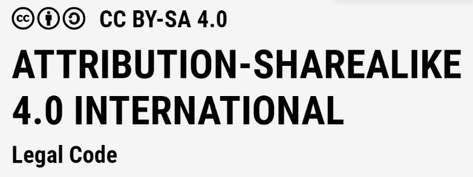

# Licence and reuse

{ width="200" }

## Published under a Creative Commons licence

By using these materials, you agree to the terms and conditions of the [CC BY-SA 4.0 International](https://creativecommons.org/licenses/by-sa/4.0/) licence. You can refer to the full licence text at the following address: <https://creativecommons.org/licenses/by-sa/4.0/legalcode.en>

You are free to:

- **share**: copy and redistribute the material in any medium or format;
- **adapt**: remix, transform, and build upon the material.

The licensor cannot revoke these freedoms as long as you follow the licence terms.

You must cite the full name of the Institut du Numérique Responsable / Institute for Sustainable IT, its web addresses <https://institutnr.org/> and <https://isit-be.org/>, as well as the date of the material.

## How to cite this guide

Any reuse, in whole or in part, including an adaptation, an evaluation grid or an excerpt, must cite the Institut du Numérique Responsable as its source. Recommended citation:

> Institut du Numérique Responsable (INR) / Institute for Sustainable IT (ISIT), *Guide to evaluating and influencing the maturity of stakeholders in Sustainable IT*, version 1.2, 2026. Licence CC BY-SA 4.0. <https://institutnr.org/guide-maturite-parties-prenantes>

If you modified the content, say so (for example: "adapted from…"). Citation metadata is also available in the repository's [`CITATION.cff`](https://github.com/Institut-du-Numerique-Responsable/guide-maturite-parties-prenantes/blob/main/CITATION.cff) file.

## Reuse rights for consultants

Anyone who wants to use this document may do so as long as they respect the property rights defined by the licence. They can produce a service or report using the template defined in this document. Any public improvement of the document must be shared under the same licence.

This guide is available at: <https://institutnr.org/guide-maturite-parties-prenantes>
